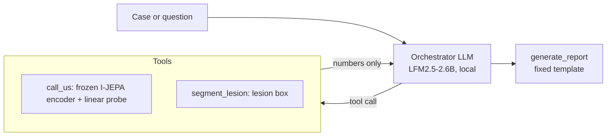
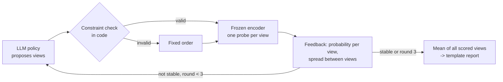

# breast-us-agent

A small, fully local agent for breast ultrasound decision support. A 2.6B-parameter LLM
(LFM2.5 via Ollama) orchestrates frozen vision tools with LangGraph. Research pilot from
an MSc thesis, not a clinical tool.

Two ideas shape the design:

1. **The LLM decides what to do, never what to say about the diagnosis.** Numbers come
   from tools. The report is a fixed template filled from tool outputs. The reference
   label never enters any prompt.
2. **A closed loop instead of one pass.** The agent proposes views of the image, a frozen
   model scores them, the scores go back to the agent, and it refines, following the
   propose / score / feedback pattern of CLARITY (Ding et al., arXiv:2512.08029).

## How it works



The closed loop (`agent/loop.py`):



Views are the whole frame, a mirrored frame, three lesion crops and the lesion box
geometry without pixels. The loop averages every scored view and never picks one: choosing
the most favourable view would be choosing the answer.

## Results

BUS-BRA validation split, 385 images, patient-grouped, one encoder seed (the thesis v3
checkpoint). The test split was not used.

| | AUROC | views per case |
|---|---|---|
| Whole frame only | 0.814 | 1 |
| Best single view (lesion crop) | 0.888 | 1 |
| Mean of all 6 views, no loop | 0.907 | 6 |
| Closed loop, fixed order | 0.905 | 3.95 |
| Closed loop, mask-free views only | 0.815 | 2 |

What these numbers do and do not show:

- The loop gets close to the all-views average with about two fewer views per case.
- The LLM policy is not better than a fixed order: 0.949 vs 0.945 on the same 60 cases.
  Its proposals passed the constraint check in 104 of 106 rounds.
- The gain depends on lesion-centred views placed with the dataset's expert mask. Without
  a mask the loop adds nothing.
- No confidence intervals yet.

Agent behaviour benchmark (10 cases x 9 questions, `agent/run_benchmark.py`): tool numbers
were quoted correctly in 10 of 10 cases and the agent refused to invent age or histology.
It did invent a BI-RADS category in 8 of 10 cases until a prompt rule was added, after
which it was 0 of 10. Full write-up (in Turkish): `docs/RESULT_AGENT_BENCHMARK_2026-09-26.md`.

## Run it

```
pip install -r requirements.txt
ollama pull oamazonasgabriel/lfm2.5-2.6b:q4_k_m-8gbGPU
printf 'FROM oamazonasgabriel/lfm2.5-2.6b:q4_k_m-8gbGPU\nPARAMETER stop <|im_end|>\n' > Modelfile
ollama create lfm2.5-2.6b-agent -f Modelfile

python -m scripts.build_bus_bra           # downloads BUS-BRA into data/
python -m agent.app                       # UI at http://127.0.0.1:7860
python -m agent.loop --n 5                # closed loop on 5 validation cases
python -m agent.loop --eval --llm-n 60    # the results table above
python -m agent.run_benchmark --n 10 --balanced
```

## Weights

The ultrasound encoder is an I-JEPA ViT-B/16 trained in the thesis (v3, seed 0), stored as
an encoder-only file with keys `encoder` and `cfg`.

```
hf auth login
hf download HF_USER/us-ijepa-v3-encoder us_ijepa_v3_encoder.pt --local-dir checkpoints
```

The linear probes are not stored: they are fit on the BUS-BRA train split at start-up
(about 30 s on a laptop CPU).

## What is not here

- **Encoder weights** are not in git (343 MB). They live in a private Hugging Face model
  repo, see "Weights" below. Without them the UI starts in a clearly marked demo mode.
- **Images.** BUS-BRA is public and fetched by the build script. Only the manifests
  (file names, labels, splits) are in the repo.
- **Mammography.** `call_mg` exists but its data and manifest are not included.

## Layout

| Path | What |
|---|---|
| `agent/graph.py` | LangGraph ReAct graph and prompts |
| `agent/loop.py` | closed loop over views, scorer, validation table |
| `agent/tools/imaging_tools.py` | the four tools, including the template report |
| `agent/app.py` | Gradio UI |
| `agent/run_benchmark.py` | behaviour benchmark with auto-scoring |
| `bjepa/`, `scripts/` | the few encoder and data modules the agent imports |
| `P3_AGENT_NOTES.md` | design decisions and limits |

## Limitations

- Single dataset, single seed, validation only.
- The lesion box comes from expert masks, which a deployed system would not have.
- On an external set (BUS-CoT, 54 images) the whole-frame probe of the earlier v2 encoder
  drops to AUROC 0.665.
- Free-text chat answers are LLM-written and less reliable than the template report.
